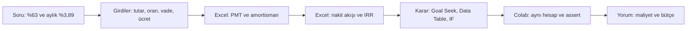
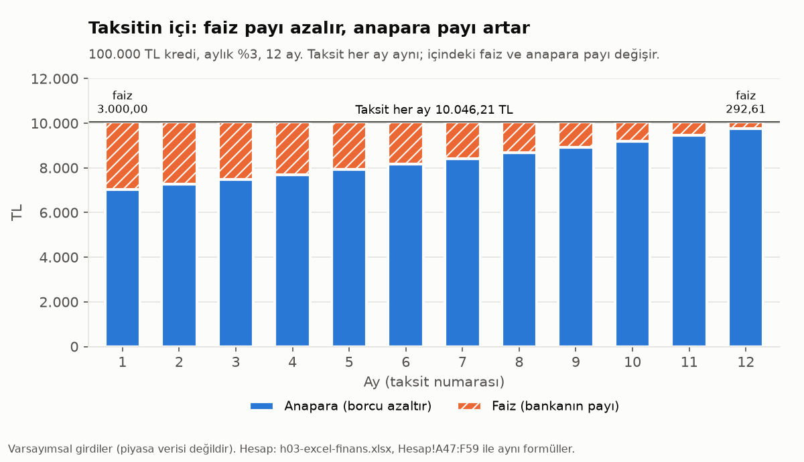
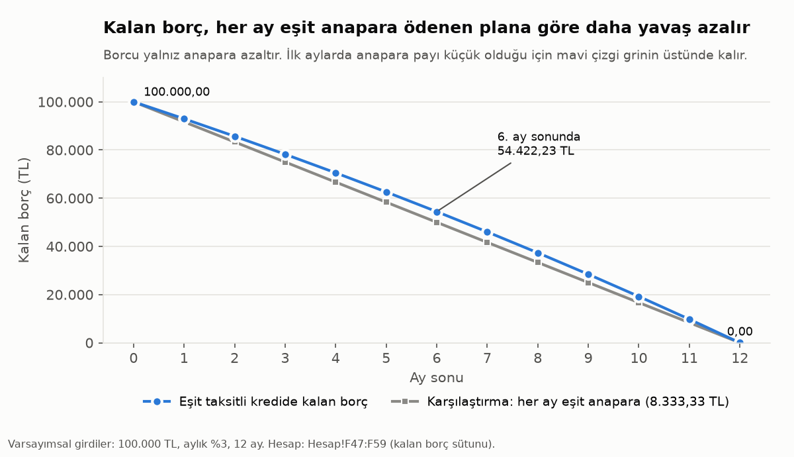
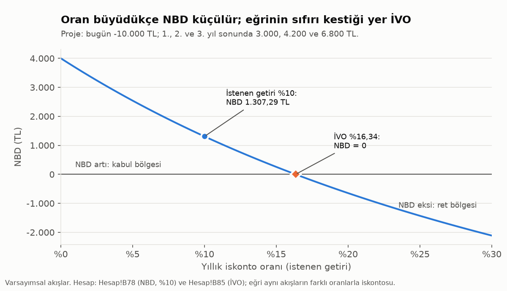

# H3 Excel II: kredi ve karar araçları (ders notu)

Bu not 4. oturumun (13 Ekim 2026) ders notudur; klasör kodu h03'tür. Oturum, eşit taksitli krediyi, amortisman tablosunu, NPV ve IRR'ı ve Excel'in karar araçlarını (Goal Seek, Data Table, IF) tek bir vakada birleştirir.

Formüller yalnız İngilizce Excel yazımıyla verilir: İngilizce fonksiyon adı, argüman ayracı virgül (`,`), ondalık ayracı nokta. Türkçe Excel'de fonksiyonun yerel adı formül çubuğunun solundaki fx düğmesiyle bulunur; argüman ayracı noktalı virgüldür (`;`). Metinde yüzdeler Türkçe yazımla verilir (%4); hücrenin değeri 0,04'tür.

Bu not `h03-excel-finans.xlsx` dosyası ve `h03-excel-finans.ipynb` defteriyle birlikte okunur. Nottaki hücre adresleri dosyadakiyle aynıdır. Goal Seek ve Data Table masaüstü Excel ister.

**Çalışma sırası:** el kitabının f03 bölümü, bu ders notu, dosyanın Finans, Hesap, Karar ve Uygulama sayfaları, defter, Ileri ve Ev sayfaları, hızlı şerit.

## İçindekiler

0. Öğrenme hedefleri
1. Haftanın vakası ve geçen haftadan bağ
2. Finans temeli
3. Bu haftanın sayıları
4. FV ve PV
5. Kredi taksiti: PMT
6. Amortisman tablosu
7. NPV ve zamanlama tuzağı
8. IRR ve kredinin maliyeti
9. TCMB'nin %63'ü nasıl hesaplanır
10. Goal Seek
11. Data Table
12. IF, AND, OR
13. Vakanın çözümü
14. Colab aynası
15. Hızlı şerit (notsuz)
16. Uygulama: G1-G4, Ileri ve Ev
17. Tuzaklar ve hatalar
18. Alıştırma soruları
19. Özet ve sonraki oturum
20. Sözlük
21. Kaynaklar ve veri notu
22. Alıştırma sorularının cevapları

---

## Kısaltmalar

Bu notta geçen kısaltmalar ve Excel fonksiyon adları.

| Kısaltma | Açılımı | Türkçesi | Notta nerede |
|---|---|---|---|
| FV | Future Value | Gelecekteki değer | 4 |
| PV | Present Value | Bugünkü değer | 2, 4, 10 |
| PMT | Payment | Dönem ödemesi (taksit) | 2, 5, 10, 11 |
| NPER | Number of Periods | Dönem sayısı | 5, 16 |
| RATE | kısaltma değil | Dönem faiz oranı | 8, 16 |
| IPMT | Interest Payment | Taksitin faiz payı | 6, 14 |
| PPMT | Principal Payment | Taksitin anapara payı | 6 |
| NPV | Net Present Value | Net bugünkü değer | 7, 8 |
| IRR | Internal Rate of Return | İç verim oranı | 8, 9, 13, 16 |
| NBD, İVO | Net bugünkü değer, iç verim oranı | NPV ve IRR'ın Türkçe kısaltmaları | 8 (grafik) |
| XNPV | NPV'nin tarihli sürümü | Tarihli net bugünkü değer | 7, 16 |
| XIRR | IRR'ın tarihli sürümü | Tarihli iç verim oranı | 9, 15 |
| EFFECT, NOMINAL | kısaltma değil | Yıllık nominalden etkine ve etkinden nominale çevirme | 2, 9, 16 |
| EAR | Effective Annual Rate | Yıllık etkin (bileşik) oran | 9 |
| IF, AND, OR | kısaltma değil | Koşul, bütün koşullar, koşullardan biri | 12, 13, 16 |
| RANK.EQ | Rank, Equal | Sıra numarası (eşitlere aynı sıra) | 16 |
| INDEX, MATCH | kısaltma değil | Konumdaki değer; değerin konumu | 16 |
| COUNTIF | Count If | Koşula uyan hücre sayısı | 16 |
| SUM, MIN | kısaltma değil | Toplam; en küçük değer | 6, 7, 16 |
| TABLE | kısaltma değil | Data Table'ın sonuç hücrelerindeki formül | 11 |
| EYFO | Efektif Yıllık Faiz Oranı | Faiz, vergi ve ücretler dahil yıllık kredi maliyeti | 2, 8, 13 |
| KKDF | Kaynak Kullanımını Destekleme Fonu | Tüketici kredisi faizine eklenen fon kesintisi | 2, 3 |
| BSMV | Banka ve Sigorta Muameleleri Vergisi | Faize eklenen vergi | 2, 3 |
| KMH | Kredili Mevduat Hesabı | Hesaba bağlı eksi bakiye kredisi | 1, 3 |
| TCMB | Türkiye Cumhuriyet Merkez Bankası | | 1, 9 |
| PPK | Para Politikası Kurulu | TCMB'nin faiz kararını veren kurul | 1, 3 |
| npf | numpy-financial | Excel finans fonksiyonlarının Python karşılığı | 4-14 |
| PRIMM | Predict, Run, Investigate, Modify, Make | Tahmin, Çalıştırma, İnceleme, Değiştirme, Yazma | 14 |

Excel argüman adları: `rate` dönem oranı, `nper` dönem sayısı, `pmt` dönem ödemesi, `pv` bugünkü değer, `fv` gelecekteki değer, `type` ödemenin dönem sonunda (0, varsayılan) ya da başında (1) olduğu, `per` kaçıncı dönem.

## 0. Öğrenme hedefleri

Hedefler izlencedeki 1, 2, 3, 5 ve 9 numaralı öğrenme çıktılarına bağlıdır.

1. FV ve PV ile paranın zaman değerini hesaplamak ve argümanların işaretini doğru vermek.
2. PMT ile eşit taksitli kredinin taksitini bulmak; amortisman tablosunu mutlak ve karma başvuruyla kurmak, IPMT ve PPMT ile sağlamak.
3. NPV ve IRR ile bir projeyi değerlendirmek; NPV fonksiyonunun zamanlama kuralını açıklamak ve bugünkü yatırımı doğru eklemek.
4. Tahsis ücretli bir kredinin maliyetini IRR ile bulup yıllık bileşik orana çevirmek; TCMB'nin kredi faizi istatistiğinin aynı mantıkla hesaplandığını göstermek.
5. Goal Seek ile bir modeli tersine çözmek; tek ve iki değişkenli Data Table ile duyarlılık tablosu kurmak.
6. IF, AND ve OR ile bir bütçe kuralını formüle çevirmek.
7. (Finans temeli) Toplam faiz, akdi faiz, maliyet oranı ve EYFO kavramlarını ayırt etmek; vadeleri farklı kredileri doğru ölçüyle karşılaştırmak.

---

## 1. Haftanın vakası ve geçen haftadan bağ

| | |
|---|---|
| Soru | **TCMB'ye göre ihtiyaç kredisi faizi yıllık %63. İlandaki "aylık %3,89'dan başlayan faiz" bu ortalamanın neresinde; 100.000 TL için üç teklifin hangisinin maliyeti en düşük, hangisinin taksiti bütçeye sığar?** |
| Neden şimdi? | TCMB PPK toplantı özetine göre ihtiyaç kredisi (KMH hariç) faiz oranları 24 Temmuz ile biten haftaya göre 221 baz puan azalarak 4 Eylül 2026 ile biten haftada %63,0 olmuştur (Sayı 2026-42, 17.09.2026, 5. paragraf; https://www.tcmb.gov.tr/wps/wcm/connect/tr/tcmb+tr/main+menu/duyurular/basin/2026/duy2026-42, erişim 11.10.2026). TCMB bu oranı her kredinin efektif yıllık faiz oranından hesaplar (9. bölüm). |
| Veri ve dağıtım | Veri dosyası yok. %63 elle, kaynak satırıyla girilir. Üç teklif, gelir ve bütçe eşiği varsayımsaldır; piyasa verisi değildir. |
| Excel'de | Finans (f03), Hesap (FV, PV, PMT, amortisman, NPV, IRR), Karar (TCMB oranının hesabı, Goal Seek, Data Table, IF, AND, OR), Uygulama (G1, G2, G4) |
| Colab'da | Ayna: aynı hesaplar `numpy-financial` ile; G3 `taksit()`, `amortisman()` ve `maliyet()` fonksiyonları; G4 tutar × vade ızgarası |
| Hızlı şerit | TCMB metaverisindeki örneğin tarihli akışla (gün/365) yeniden bulunması; %63'e denk taksit (notsuz) |
| El kitabı | [f03: Paranın zaman değeri ve kredi](../../finans-temeli/f03-paranin-zaman-degeri-ve-kredi.md) |

**Vaka hikayesi.** Bir banka ilanında "aylık %3,89'dan başlayan faiz" yazmaktadır; haberde ise ihtiyaç kredisi faizi yıllık %63'tür. İki sayı farklı birimdedir: biri aylık akdi oran, öteki yıllık bileşik bir maliyet ortalamasıdır. Elde 100.000 TL için üç varsayımsal teklif vardır: A aylık %3,99, 12 ay, 500 TL tahsis ücreti; B aylık %4,05, 12 ay, ücretsiz; C aylık %3,89, 24 ay, 500 TL tahsis ücreti. Aylık net gelir 24.000 TL'dir ve taksitin gelirin %40'ını geçmemesi istenir (öğretim amaçlı eşik). Soru iki ayrı ölçüdür: maliyet ve bütçe.

**Vaka için gereken bilgiler.**
- Paranın zaman değeri ve iskonto (2. ve 4. bölüm)
- Taksit ve amortisman tablosu (5. ve 6. bölüm)
- Bir akışın getiri oranı: IRR ve yıllık bileşik karşılığı (8. ve 9. bölüm)
- Tersine çözüm, duyarlılık ve karar kuralı (10-12. bölüm)

Aşağıdaki şema haftanın hattını gösterir.



**Geçen haftadan bağ.** 6 Ekim'de aylık %3'ün yıllık nominal karşılığı %36, yıllık etkin karşılığı `=(1+B31)^B32-1` ile %42,58 bulundu. Bu oturumda aynı dönüşüm ters yönde de kullanılır: yıllık bileşik %63, aylık bileşik karşılığına çevrilir. 10.000 TL'nin yıllık %40 ile 3 yılda 27.440 TL olması bir FV hesabıdır; tersi PV'dir. H2 ders notunun 10. bölümündeki kredi örneği bu oturumda derste kurulur.

> **Tahmin sorusu:** Yıllık %63'ün aylık karşılığı kaçtır?
>
> <details><summary>Cevap</summary>%4,16 (Karar!B44): <code>=(1+B9)^(1/B10)-1</code>. 63 / 12 = %5,25 yanlış okumadır; aylık %5,25 bileşik olarak yılda %84,78 eder.</details>

---

## 2. Finans temeli

Teorinin 5-25. dakikası bu konuya ayrılır. Kavramların tam anlatımı, sayılı örnekler ve Türkiye'deki kurallar el kitabındadır: [El kitabı f03: Paranın zaman değeri ve kredi](../../finans-temeli/f03-paranin-zaman-degeri-ve-kredi.md). Bu bölümde özet ve dosyadaki yer verilir.

**Özet**
- **Paranın zaman değeri.** Bugünkü 1 TL, gelecekteki 1 TL'den değerlidir, çünkü bugün faize konup büyüyebilir. Gelecekteki tutarı bugüne taşımaya **iskonto** (discounting) denir: 27.440 / 1,40^3 = 10.000 TL.
- **Anüite ve eşit taksit.** Eşit aralıklarla ödenen eşit tutarlar dizisine **anüite** (annuity) denir. Taksit, bütün taksitlerin bugünkü değerleri toplamı kredi tutarına eşit olacak biçimde seçilir.
- **Toplam faiz.** Toplam faiz = taksit × vade - kredi tutarı. 100.000 TL, aylık %3, 12 ay için 20.554,50 TL'dir; "kredi × oran × vade" hesabı 36.000 TL verir ve yanlıştır.
- **Aylık oranın yıllık karşılığı.** Nominal: aylık oran × 12; aylık %3 için %36. Etkin (bileşik): (1 + aylık oran)^12 - 1; aylık %3 için %42,58. İki oranın farkı 6,58 yüzde puandır ve faizin faize işlemesinden gelir.
- **Kredinin gerçek maliyeti.** Sözleşmede yazan orana **akdi faiz** denir. Tahsis ücreti ele geçen tutarı azaltır ve maliyeti yükseltir. KKDF faiz tutarı, BSMV bankanın lehine aldığı paralar (başlıcası faiz) üzerinden alınır. Faiz, vergi ve ücretlerin hepsini içeren yıllık orana **efektif yıllık faiz oranı** (EYFO) denir.

> [!IMPORTANT]
> **Haftanın kuralı.** Bir oran görüldüğünde önce dönemi (aylık mı, yıllık mı), türü (nominal mi, bileşik mi) ve kapsamı (yalnız faiz mi, ücret ve vergi dahil mi) sorulur. Yıllık etkin oran yalnız akdi faizin bileşik karşılığıdır; EYFO vergi ve ücretleri de içerir.

### Excel'de: Finans sayfası

Dosyada Oku'dan sonraki ilk sayfa Finans'tır. Girdiler (mavi) ve formüller aynı sayfada durur.

| Blok | Hücre | Excel | Sonuç |
|---|---|---|---|
| F1 İskonto çarpanı | Finans!B10 | `=1/(1+B7)^B8` | 0,3644 |
| F1 Bugünkü değer | Finans!B11 | `=B6*B10` | 10.000,00 TL |
| F1 Sağlama | Finans!B12 | `=-PV(B7,B8,0,B6)` | 10.000,00 TL |
| F2 Taksit | Finans!B22 | `=-PMT(B18,B19,B17)` | 10.046,21 TL |
| F2 Toplam ödeme | Finans!B23 | `=B22*B19` | 120.554,50 TL |
| F2 Toplam faiz | Finans!B24 | `=B23-B17` | 20.554,50 TL |
| F2 Yanlış tahmin | Finans!B28 | `=B17*B18*B19` | 36.000,00 TL |
| F2 Tahminin fazlası | Finans!B29 | `=B28-B24` | 15.445,50 TL |
| F3 Yıllık nominal | Finans!B33 | `=B31*B32` | %36,00 |
| F3 Yıllık etkin | Finans!B34 | `=(1+B31)^B32-1` | %42,58 |
| F3 Sağlama | Finans!B35 | `=EFFECT(B33,B32)` | %42,58 |

F4 hesap içermez; kredinin maliyetine giren kalemleri (akdi faiz, KKDF, BSMV, tahsis ücreti, EYFO) özetler.

### Pratik ve finans alıştırması

- **Pratik P1-P3 (sarı hücreler):** iskonto, taksit ve toplam faiz, nominal ve etkin oran; F1-F3'ün kalıbıyla, yeni sayılarla. Cevaplar derste tartışılır.
- **Finans alıştırması:** Aynı krediden banka peşin 500 TL tahsis ücreti keser. Ele geçen tutar ve 12 taksit Finans!B80:B92'ye nakit akışı olarak yazılır, aylık maliyet IRR ile bulunur (8. bölüm). Finans!B94'teki fark, sonucu Ileri!B21'deki RATE sonucuyla sağlar.

Finans teorisi paralel yürüyen FTEK 505 dersindedir. Burada finans, hesap tablosu için örnek bağlamı ve günlük kararlar için temel okuryazarlıktır.

---

## 3. Bu haftanın sayıları

Bu hafta veri dosyası yoktur. Gerçek sayılar elle ve kaynağıyla girilir; kredi, proje ve teklif sayıları varsayımsaldır.

| Sayı | Değer | Kaynak ve tarih |
|---|---|---|
| İhtiyaç kredisi (KMH hariç) faiz oranı | %63,0; 4 Eylül 2026 ile biten hafta | TCMB PPK toplantı özeti, Sayı 2026-42, 17.09.2026, 5. paragraf |
| Aynı oranın değişimi | 24 Temmuz ile biten haftaya göre 221 baz puan (2,21 puan) azalış | Aynı kaynak |
| TCMB metaverisi örneği | 10.000 TL, 24 ay, ayda 480 TL; efektif yıllık faiz oranı %14,90 | TCMB, Kredi Faiz Oranları metaverisi (güncelleme 27.04.2026) |
| Politika faizi | %37, sabit tutuldu | TCMB basın duyurusu 2026-38, 10.09.2026 |
| KKDF ve BSMV, tüketici kredisi | %15 ve %15 | El kitabı f03, 4. bölüm |
| Tahsis ücreti sınırı | Anaparanın binde beşi; 100.000 TL'de en çok 500 TL | TCMB Tebliği 2020/7 md. 10/1 |
| Üç teklif | A %3,99, 12 ay, 500 TL; B %4,05, 12 ay, 0 TL; C %3,89, 24 ay, 500 TL | Varsayımsal |
| Gelir ve eşik | 24.000 TL; taksit / gelir en çok %40 | Varsayımsal, öğretim amaçlı |
| Çalışılmış örnekler | 100.000 TL, aylık %3, 12 ay (Hesap); aylık %4, 12 ay (Karar); proje -10.000, 3.000, 4.200, 6.800 TL | Varsayımsal |

URL'ler 21. bölümdedir. Vergiler (KKDF, BSMV) modele girmez; bu yüzden tekliflerin maliyeti "vergiler hariç" diye okunur. TCMB metaverisi vergi ve ücretlerin %63'e girip girmediğini yazmaz; bu nokta doğrulanmamıştır.

**Dosyanın düzeni.** Girdiler sayfası Hesap ve Cikti'nin bütün varsayımlarını (mavi), Hesap sayfası hesapları, Cikti sayfası karar özetini tutar. Hesap!B39'daki `=Girdiler!B15`, "Girdiler sayfasının B15 hücresini getir" demektir. Karar ve Uygulama sayfalarının girdileri kendi içindedir, çünkü Data Table'ın girdi hücresi tabloyla aynı sayfada olmalıdır (17. bölüm, T12). Tabloların başındaki gri italik 0'lar "dönem 0" satırını başlatan yapısal değerlerdir.

---

## 4. FV ve PV

**Tanım.** **Gelecekteki değer** (future value, FV), bugünkü paranın ve düzenli ödemelerin süre sonundaki değeridir. **Bugünkü değer** (present value, PV), gelecekteki bir tutarın bugüne iskonto edilmiş değeridir. İki fonksiyon da **işaret kuralını** (sign convention) izler: cepten çıkan para eksi, cebe giren para artıdır.

**Sezgi.** FV parayı ileri, PV geri taşır. Banka hesap özetinde yatırılan ve çekilen para ayrı sütunlarda durur; finans fonksiyonları da parayı yönüyle okur.

**Sayılı örnek.** Her ayın sonunda 1.000 TL, aylık %3, 12 ay. İlk ay yatırılan para 11 ay faiz kazanır, son ay yatırılan hiç kazanmaz. Tersine hesap: 3 yıl sonraki 27.440 TL, yıllık %40 ile bugün 27.440 / 2,744 = 10.000 TL eder.

**Excel'de (Hesap, satır 4-36).**

| Etiket | Hücre | Excel | Sonuç |
|---|---|---|---|
| [H] Birikim | Hesap!B10 | `=FV(B5,B6,-B7)` | 14.192,03 TL |
| [İ] Katkı artı verilirse | Hesap!B11 | `=FV(B5,B6,B7)` | -14.192,03 TL |
| [S] Ay ay tablonun sonu | Hesap!E26 | `=B26+C26+D26` | 14.192,03 TL |
| [S] Fark | Hesap!B28 | `=E26-B10` | 0,000000 |
| [H] Tersine hesap | Hesap!B34 | `=PV(B32,B33,0,B31)` | -10.000,00 TL |
| [S] İleri taşıma | Hesap!B35 | `=-B34*(1+B32)^B33` | 27.440,00 TL |

FV'nin 4. argümanı (`pv`) yazılmaz, çünkü hesap boş başlar. PV'nin 3. argümanı 0'dır, çünkü arada düzenli ödeme yoktur. Hesap!A13:E26'daki ay ay tablo FV'nin içini gösterir: C15 `=B15*$B$5` faizi, D15 `=$B$7` katkıyı hesaplar.

**Python'da.** Defterin "Örnek 1" ve "Örnek 1b" bölümleri:

```python
import numpy_financial as npf
print(npf.fv(0.03, 12, -1000, 0))   # 14192.029561539312
print(npf.pv(0.40, 3, 0, 27440))    # -10000.000000000002
```

`npf.fv`'de 4. argüman zorunludur; Excel'de boş bırakılabilir. İkinci satırın sonundaki küçük artık, bilgisayarın ondalık sayıları yaklaşık tutmasından gelir.

**İşaretin okunuşu.** Aynı işlemin iki tarafı ters işaret taşır. Birikimde her ay yatırılan katkı eksi, süre sonunda alınan toplam artıdır. Tersine hesapta bugün yatırılan tutar eksi, 3 yıl sonra alınan 27.440 TL artıdır. Bu yüzden Hesap!B34 -10.000,00 gösterir; Cikti!B12 aynı tutarı `=-Hesap!B34` ile artı gösterir.

**Nerede kullanılır.** Birikim ve emeklilik planı, tahvil fiyatı, kira geliri olan bir varlığın değeri: her değerleme gelecekteki akışları bugüne taşır.

**Sık hata.** PV'de 3. argümanı atlamak: `=PV(0.40,3,27440)` -43.600,00 verir (17. bölüm, T9).

> **Tahmin sorusu:** 12 ayda 12 × 1.000 = 12.000 TL yatırılır. Hesap!B10'daki birikim bundan büyük mü, küçük mü?
>
> <details><summary>Cevap</summary>Büyük: 14.192,03 TL. Aradaki 2.192,03 TL faizdir; erken yatırılan para daha çok ay faiz kazanır.</details>

---

## 5. Kredi taksiti: PMT

**Tanım.** Eşit taksitli kredide **taksit**, bütün taksitlerin kredi oranıyla bugüne iskonto edilmiş toplamı kredi tutarına eşit olacak biçimde seçilir. `PMT` (payment, dönem ödemesi) bu taksiti verir.

**Sezgi.** Banka bugün 100.000 TL verir. Aldığı 12 taksiti aylık %3 ile bugüne taşıdığında tam 100.000 TL bulmalıdır. Taksit bu eşitliği sağlayan tek sayıdır.

**Sayılı örnek.** Formül: taksit = P × r / (1 - (1 + r)^(-n)). P = 100.000, r = 0,03, n = 12: 1,03^(-12) = 0,7014; 1 - 0,7014 = 0,2986; 100.000 × 0,03 / 0,2986 = 10.046,21 TL. Toplam faiz 10.046,21 × 12 - 100.000 = 20.554,50 TL.

**Excel'de (Hesap, satır 38-43 ve 62-66).**

| Etiket | Hücre | Excel | Sonuç |
|---|---|---|---|
| [D] | | Oran aylık, vade ay: uyumlu | |
| [İ] | | Kredi borçluya gelir (artı), taksit çıkar (eksi) | |
| [H] Taksit | Hesap!B43 | `=-PMT(B40,B41,B39)` | 10.046,21 TL |
| [H] Toplam ödeme | Hesap!B64 | `=B43*B41` | 120.554,50 TL |
| [H] Toplam faiz | Hesap!B65 | `=B64-B39` | 20.554,50 TL |
| [S] Kapalı formül | Ileri!B9 | `=B6*B7/(1-(1+B7)^(-B8))` | 10.046,21 TL |

PMT taksiti eksi verir, çünkü taksit borçludan çıkan paradır; baştaki eksi taksiti artı gösterir. Taksitin iki sağlaması vardır. Birincisi: 1. ayın faizi ile anapara payının toplamı taksite eşittir: 3.000,00 + 7.046,21 = 10.046,21 (Finans!B25 ve B26). İkincisi: 12 taksit kendi ayı kadar iskonto edilip toplanırsa 100.000 TL bulunur. PMT'nin `type` argümanı boş bırakılır; krediler dönem sonunda ödenir. Vade uzarsa taksit düşer, toplam faiz artar:

| Vade | Taksit | Toplam faiz |
|---|---|---|
| 12 ay | 10.046,21 TL | 20.554,50 TL |
| 18 ay | 7.270,87 TL | 30.875,65 TL |
| 24 ay | 5.904,74 TL | 41.713,80 TL |

Ters soru `NPER` ile sorulur: "Ayda 7.500 TL ödenirse borç kaç ayda biter?" `=NPER(B26,-B27,B28,B29)` Ileri!B31'de 17,28 ay verir.

**Python'da.** Defterin "Örnek 2" bölümü:

```python
taksit = -npf.pmt(0.03, 12, 100000)
print(round(taksit, 2), round(taksit * 12 - 100000, 2))   # 10046.21 20554.5
```

**Nerede kullanılır.** Tüketici, taşıt ve konut kredileri, kira sözleşmeleri ve emeklilik ödemeleri anüite mantığıyla hesaplanır.

**Sık hata.** Yıllık oranı aylık hesapta kullanmak (T3).

> **Tahmin sorusu:** PMT'ye aylık %3 yerine yıllık %36 verilirse (vade yine 12 ay) taksit ne olur?
>
> <details><summary>Cevap</summary>36.922,19 TL: gerçek taksitin üç katından fazla. Fonksiyon %36'yı aylık oran sayar; oran ve dönem aynı birimde olmalıdır.</details>

---

## 6. Amortisman tablosu

**Tanım.** **Amortisman tablosu** (amortization schedule), kredinin her dönemdeki dökümüdür: başlangıç borcu, faiz, anapara payı, taksit ve kalan borç. Son dönemde kalan borç sıfırsa tablo doğrudur. Muhasebedeki "amortisman" (duran varlığın değer kaybı) başka bir kavramdır.

**Sezgi.** Her ay önce kalan borcun faizi ödenir; taksitin geri kalanı borcu azaltır. Borç azaldıkça faiz payı küçülür, anapara payı büyür.

**Sayılı örnek.** 1. ay: faiz 100.000 × %3 = 3.000,00; anapara 10.046,21 - 3.000,00 = 7.046,21; kalan 92.953,79. 2. ay: faiz 92.953,79 × %3 = 2.788,61; anapara 7.257,59; kalan 85.696,20.

**Excel'de (Hesap!A46:J59).** F47 `=B39` dönem 0'da borcu başlatır. 48. satır yazılıp 59. satıra sürüklenir:

| Etiket | Hücre | Excel | Sonuç |
|---|---|---|---|
| [H] Faiz | Hesap!C48 | `=B48*$B$40` | 3.000,00 |
| [H] Anapara | Hesap!D48 | `=E48-C48` | 7.046,21 |
| [H] Kalan borç | Hesap!F48 | `=B48-D48` | 92.953,79 |
| [S] Faiz farkı | Hesap!I48 | `=C48-G48`; G48 `=-IPMT($B$40,A48,$B$41,$B$39)` | 0,000000 |
| [H] Son ayın faizi | Hesap!C59 | aynı kalıp | 292,61 |
| [S] Son kalan borç | Hesap!F59 | aynı kalıp | 0,000000 |
| [H] Toplam faiz | Hesap!C60 | `=SUM(C48:C59)` | 20.554,50 |
| [H] Toplam anapara | Hesap!D60 | `=SUM(D48:D59)` | 100.000,00 |
| [S] Anapara farkı | Hesap!J59 | `=D59-H59`; H59 `=-PPMT($B$40,A59,$B$41,$B$39)` | 0,000000 |

`$B$40` **mutlak başvurudur** (absolute reference): sürüklendiğinde kaymaz. IPMT'nin 2. argümanı (`per`, kaçıncı dönem) göreli kalır. **Karma başvuru** (mixed reference) yalnız satırı ya da yalnız sütunu sabitler: `$A95` sütunu, `B$94` satırı sabitler (Karar K5 ve G1). Windows'ta F4 tuşu başvuruyu `$B$40`, `B$40`, `$B40`, `B40` sırasıyla değiştirir.



*Grafiğin yorumu.* Sütunların boyu sabittir, çünkü taksit sabittir. Taralı faiz payı her ay küçülür, anapara payı büyür; sayılar Hesap!A47:F59 ile aynıdır.



*Grafiğin yorumu.* Kalan borç 12. ayda sıfıra iner. İlk aylarda anapara payı küçük olduğu için borç, her ay 8.333,33 TL azalan karşılaştırma planından yavaş azalır: 6. ay sonunda 54.422,23 TL kalır, karşılaştırma planında 50.000 TL.

**Python'da.** Defterdeki amortisman döngüsünün özü:

```python
kalan = 100000
for ay in range(1, 13):
    faiz = kalan * 0.03
    anapara = taksit - faiz
    kalan = kalan - anapara
    assert abs(faiz + npf.ipmt(0.03, ay, 12, 100000)) < 0.01   # IPMT sağlaması
print(round(faiz, 2), round(anapara, 2), round(abs(kalan), 6))   # 292.61 9753.6 0.0
```

**Nerede kullanılır.** Bankanın ödeme planı, erken kapamada kalan borç ve faiz giderinin dönemlere dağıtılması.

**Sık hata.** `$` unutmak (T8) ya da kalan borcu "başlangıç - taksit" ile bulmak: faiz borcu azaltmaz, son kalan borç sıfır çıkmaz.

> **Tahmin sorusu:** Taksit her ay aynıdır. Taksitin içindeki faiz payı aydan aya artar mı, azalır mı?
>
> <details><summary>Cevap</summary>Azalır: 1. ayda 3.000,00, 12. ayda 292,61 (Hesap!C59). Faiz kalan borca işler ve kalan borç her ay azalır.</details>

---

## 7. NPV ve zamanlama tuzağı

**Tanım.** **Net bugünkü değer** (net present value, NPV), bütün nakit akışlarının (bugünkü yatırım dahil) **istenen getiri** (required return) ile bugüne iskonto edilmiş toplamıdır. NPV artıysa proje istenen getiriden fazlasını kazandırır: kabul.

**Sezgi.** Farklı yıllarda gelen paralar doğrudan toplanmaz; her biri bugüne taşınıp toplanır. İstenen getiri, paranın bir sonraki en iyi kullanımının getirisidir.

**Sayılı örnek.** Proje bugün 10.000 TL ister; 1., 2. ve 3. yıl sonunda 3.000, 4.200 ve 6.800 TL getirir; istenen getiri yıllık %10.

| Dönem | Akış | İskonto çarpanı | Bugünkü değer |
|---|---|---|---|
| 0 | -10.000 | 1,0000 | -10.000,00 |
| 1 | 3.000 | 0,9091 | 2.727,27 |
| 2 | 4.200 | 0,8264 | 3.471,07 |
| 3 | 6.800 | 0,7513 | 5.108,94 |
| Toplam | | | **1.307,29** |

**Excel'de (Hesap, satır 68-83).**

| Etiket | Hücre | Excel | Sonuç |
|---|---|---|---|
| [H] Elle toplam | Hesap!C76 | `=SUM(C72:C75)`; C72 `=B72/(1+$B$69)^A72` | 1.307,29 TL |
| [H] Doğru kurulum | Hesap!B78 | `=NPV(B69,B73:B75)+B72` | **1.307,29 TL** |
| [H] Tuzak kurulum | Hesap!B79 | `=NPV(B69,B72:B75)` | 1.188,44 TL |
| [S] Kaydırılmış toplam | Hesap!D76 | `=SUM(D72:D75)` | 1.188,44 TL |
| [S] Oran | Hesap!B82 | `=B78/B79` | 1,10 |

**Tuzağın nedeni.** Excel'in `NPV` fonksiyonu listedeki ilk değeri 1. dönemin sonunda sayar; Microsoft'un belgesine göre NPV yatırımı, ilk akışın tarihinden bir dönem önce başlar. B72:B75 verilirse bugünkü -10.000 de bir yıl sağa kayar ve her akış bir kez fazla 1,10'a bölünür: 1.307,29 / 1,10 = 1.188,44. Hesap!D72:D75 bu kaymayı `=B72/(1+$B$69)^(A72+1)` ile gösterir.

> [!WARNING]
> **NPV tuzağı.** Yatırım bugün yapılırsa dönem 0 akışı fonksiyonun dışında eklenir: `=NPV(B69,B73:B75)+B72`. Bütün akışları NPV'nin içine vermek sonucu (1 + oran) ile böler.

**Python'da.** `npf.npv` ilk değeri bugün (t = 0) sayar; zamanlama Excel'in tersidir:

```python
akislar = [-10000, 3000, 4200, 6800]
print(npf.npv(0.10, akislar))          # 1307.287753568743: Excel'deki doğru kurulum
print(npf.npv(0.10, [0] + akislar))    # 1188.4434123352216: Excel'deki tuzak
```

İkinci satırdaki `[0] + akislar` listenin başına 0 ekler: "bugün hiçbir şey yok, yatırım bir dönem sonra". Excel'in tuzak kurulumu tam olarak budur. Akışlar eşit aralıklı değilse tarihli `XNPV` kullanılır (Ileri 5, Ileri!B53: 2.297,31 TL).

**[Y] Yorum.** NPV 1.307,29 TL'dir: proje yıllık %10 getiriyi sağladıktan sonra bugünkü parayla 1.307,29 TL daha kazandırır. NPV'nin 0 olması projenin kötü olduğunu göstermez; proje tam istenen getiriyi sağlar.

**Nerede kullanılır.** Yatırım (sermaye bütçelemesi) kararları, şirket değerlemesi ve proje finansmanı. Teorisi FTEK 505'tedir.

**Sık hata.** Bir örneği kopyalarken yatırımın bugün mü, bir dönem sonra mı yapıldığına bakmamak (T1).

> **Tahmin sorusu:** Bütün akışlar NPV'nin içine verilip `=NPV(B69,B72:B75)` yazılırsa sonuç 1.307,29 mu çıkar?
>
> <details><summary>Cevap</summary>Hayır: 1.188,44 TL (Hesap!B79). Bugünkü -10.000 TL de bir yıl sonraya kayar ve her şey bir kez fazla 1,10'a bölünür.</details>

---

## 8. IRR ve kredinin maliyeti

**Tanım.** **İç verim oranı** (internal rate of return, IRR), NPV'yi sıfır yapan iskonto oranıdır. Projede IRR, projenin kendi getiri oranıdır; kredide, borçlunun gözünden kredinin **dönem maliyetidir**.

**Sezgi.** Oran büyüdükçe gelecekteki girişlerin bugünkü değeri küçülür ve NPV azalır. Bir oranda NPV tam sıfırdır; o oran IRR'dır.

**Sayılı örnek.** Projede %10'da NPV 1.307,29 TL, %15'te 255,61 TL, %20'de -648,15 TL'dir. Sıfır %15 ile %20 arasındadır: %16,34.

**Excel'de.**

| Etiket | Hücre | Excel | Sonuç |
|---|---|---|---|
| [H] Proje IRR | Hesap!B85 | `=IRR(B72:B75)` | %16,34 |
| [S] IRR'da NPV | Hesap!B86 | `=NPV(B85,B73:B75)+B72` | 0,000000 |
| [Y] NPV kuralı | Hesap!B88 | `=IF(B78>0,"Kabul","Ret")` | Kabul |
| [Y] IRR kuralı | Hesap!B89 | `=IF(B85>B69,"Kabul","Ret")` | Kabul |
| [H] Ücretli kredi, RATE | Ileri!B21 | `=RATE(B17,-B19,B20)` | %3,08 |
| [H] Ücretli kredi, IRR | Finans!B93 | `=IRR(B80:B92)` | %3,08 |
| [S] İki yolun farkı | Finans!B94 | `=B93-Ileri!B21` | 0,000000 |
| [H] Vergiler hariç yıllık | Finans!B95 | `=(1+B93)^B75-1` | %43,98 |
| [H] Ücretsiz yıllık | Finans!B96 | `=(1+B72)^B75-1` | %42,58 |
| [Y] Ücretin eklediği | Finans!B98 | `=(B95-B96)*B97` | 1,40 puan |

IRR'a yatırım dahil bütün akışlar verilir; NPV'nin zamanlama tuzağı burada yoktur. Kredi akışı: ay 0'da ele geçen +99.500 TL, ay 1-12'de -10.046,21 TL. Ücret taksiti değiştirmez, ama daha az parayla aynı taksit daha yüksek oran demektir. İki oranın farkı **yüzde puandır** (percentage point). Aynı hesabın iki bakışı vardır: projede IRR yatırılan paranın kazancı, kredide borçlunun ödediği orandır; değişen yalnız akışların işaretidir. RATE aynı oranı akış tablosu kurmadan bulur: "B20 kadar para alınıp B17 ay boyunca her ay B19 ödenirse aylık oran nedir?"



*Grafiğin yorumu.* İstenen getiri IRR'dan küçükse NPV artı, büyükse eksidir. Önce yatırım, sonra hep giriş olan bu tür projede iki karar kuralı aynı kararı verir. Grafikte NPV için Türkçe kısaltma NBD, IRR için İVO kullanılmıştır.

**Python'da.** Defterin "Örnek 3" ve "Örnek 4" bölümleri:

```python
print(round(npf.irr(akislar), 6))                         # 0.163406
aylik = npf.irr([99500] + [-taksit] * 12)
print(round(aylik, 6), round((1 + aylik) ** 12 - 1, 6))   # 0.030841 0.439789
```

**Nerede kullanılır.** Proje getirisi, fon ve girişim sermayesi getirisi, tahvilde vadeye kadar getiri ve kredilerin maliyet oranı (EYFO).

**Sık hata.** Akıştaki bütün değerleri aynı işaretle yazmak (T11) ya da ay 0'a ele geçen tutar yerine sözleşmedeki 100.000 TL'yi yazmak: o zaman ücretin etkisi kaybolur.

> **Tahmin sorusu:** 500 TL tahsis ücreti taksiti değiştirmez. Kredinin aylık maliyeti yine %3 müdür?
>
> <details><summary>Cevap</summary>Hayır: %3,08. Ele 99.500 TL geçer, ama 100.000 TL'nin taksiti ödenir; yıllık maliyet %42,58'den %43,98'e çıkar.</details>

---

## 9. TCMB'nin %63'ü nasıl hesaplanır

**Tanım.** TCMB'nin kredi faizi istatistiğinde her kredinin **efektif yıllık faiz oranı** hesaplanır, sonra bu oranların ağırlıklı ortalaması alınır. Metaveriye göre bu oran, sözleşmedeki bütün faiz ve anapara ödemelerinin bugünkü değerini kredi tutarına eşitleyen yıllık orandır; iskonto çarpanı (1 + oran)^(-t/365), t gün sayısıdır. Bu, ödeme akışının tarihli iç verim oranıdır (`XIRR`); aylık IRR'ın yıllık bileşik karşılığı, yani **yıllık etkin oran** (effective annual rate, EAR), çok yakın bir sonuç verir.

**Sezgi.** %63 bir ilan oranı değil, ödeme akışlarından geriye doğru çözülmüş bir maliyet ortalamasıdır. Aynı hesap Excel'de birkaç hücreyle yeniden kurulur.

**Sayılı örnek.** Metaverideki örnek: 10.000 TL kredi, 24 ay boyunca ayda 480 TL. Aylık IRR %1,1644; yıllık bileşik karşılığı 1,011644^12 - 1 = %14,90.

**Excel'de (Karar, K1).** Karar!C14:C38 akışı tutar: ay 0'da +10.000, ay 1-24'te -480. B14:B38'de 01.01.2012'den başlayan aylık tarihler vardır.

| Etiket | Hücre | Excel | Sonuç |
|---|---|---|---|
| [H] Aylık IRR | Karar!B40 | `=IRR(C14:C38)` | %1,1644 |
| [H] Yıllık bileşik | Karar!B41 | `=(1+B40)^B10-1` | %14,90 |
| [H] Tarihli akışla | Karar!B42 | `=XIRR(C14:C38,B14:B38)` | %14,90 |
| [H] İki yolun farkı | Karar!B43 | `=(B41-B42)*B11` | 0,0067 puan |
| [H] %63'ün aylık karşılığı | Karar!B44 | `=(1+B9)^(1/B10)-1` | %4,16 |
| [H] Yanlış okuma | Karar!B45 | `=B9/B10` | %5,25 |

`XIRR` her akışı kendi tarihiyle, gün sayısı / 365 üssüyle iskonto eder; TCMB'nin formülü de budur. Aylar 28-31 gün sürdüğü için iki yol çok küçük bir farkla ayrılır. Yıllık bileşik oran 12'ye bölünmez; bölme yalnız yıllık nominalden aylık orana geçerken kullanılır. Aynı mantıkla Karar!B58 aylık %4'lük çalışılmış örneğin yıllık karşılığını %60,10 bulur; `=EFFECT(0.48,12)` aynı sonucu verir, çünkü EFFECT yıllık nominal oranı (%48) ister.

**Python'da.** Defterin "Vaka" bölümü:

```python
aylik_tcmb = npf.irr([10000] + [-480] * 24)
print(round(aylik_tcmb, 6), round((1 + aylik_tcmb) ** 12 - 1, 6))   # 0.011644 0.149032
print(round(1.63 ** (1 / 12) - 1, 6), 0.63 / 12)                    # 0.041555 0.0525
```

`numpy-financial`'da `XIRR`'ın karşılığı yoktur; hızlı şeritte oran ikiye bölme yöntemiyle bulunur.

**Nerede kullanılır.** TCMB'nin kredi faizi istatistiği, kredi sözleşmelerindeki EYFO ve farklı ödeme planlı tekliflerin tek ölçüye çevrilmesi.

**Sık hata.** %63'ü 12'ye bölmek (T4) ve politika faiziyle karşılaştırmak (T13).

> **Tahmin sorusu:** Metaverideki akışın yıllık oranı IRR yoluyla (Karar!B41) ve XIRR yoluyla (Karar!B42) bulunur. İki sonuç tam aynı mıdır?
>
> <details><summary>Cevap</summary>Hayır, ama ikisi de %14,90'a yuvarlanır: %14,9032 ve %14,8966. Fark 0,0067 puandır ve ayların gün sayısının eşit olmamasından gelir.</details>

---

## 10. Goal Seek

**Tanım.** `Goal Seek` (hedef arama), bir formül hücresinin istenen değeri alması için tek bir girdi hücresini deneme yanılmayla (yinelemeli) değiştirir. Soru "sonuç şu olsun, girdi ne olmalı?" biçimindedir.

**Sezgi.** PMT tutardan taksite gider. Goal Seek aynı modeli tersine çalıştırır: taksit verilir, tutar bulunur.

**Sayılı örnek.** Karar sayfasındaki çalışılmış örnek varsayımsal bir ilan kredisidir: 100.000 TL, aylık %4, 12 ay. Taksit 10.655,22 TL'dir, gelirin %44,40'ıdır. Ödenebilecek en yüksek taksit 7.500 TL ise kredi en çok kaç TL olur?

**Excel'de (Karar, K2).** Data > What-If Analysis > Goal Seek. Set cell: B62. To value: 7500. By changing cell: B61.

| Etiket | Hücre | Excel | Sonuç |
|---|---|---|---|
| [H] Taksit | Karar!B56 | `=-PMT(B49,B50,B48)` | 10.655,22 TL |
| [H] Toplam faiz | Karar!B57 | `=B56*B50-B48` | 27.862,61 TL |
| [H] Yıllık bileşik | Karar!B58 | `=(1+B49)^B10-1` | %60,10 |
| [H] Taksit / gelir | Karar!B59 | `=B56/B51` | %44,40 |
| [H] Goal Seek'ten önce | Karar!B62 | `=-PMT(B49,B50,B61)` | 10.655,22 TL |
| [S] Aynı soru PV ile | Karar!B64 | `=PV(B49,B50,-B53)` | 70.388,05 TL |

Goal Seek'ten sonra B61 70.388,05 TL, B62 7.500,00 TL olur. Set cell bir formül, By changing cell sabit bir değer olmalıdır. Birden çok girdi ve kısıt için Solver kullanılır (12. oturum).

> [!NOTE]
> **Masaüstü Excel.** Goal Seek ve Data Table Web için Excel'de yoktur. Bu oturumdan itibaren masaüstü Excel gerekir.

**Python'da.** Kapalı çözüm `npf.pv`'dir; Goal Seek'in yaptığı aramanın bir karşılığı ikiye bölmedir:

```python
alt, ust = 0, 100000
for _ in range(60):
    orta = (alt + ust) / 2
    if -npf.pmt(0.04, 12, orta) > 7500:
        ust = orta
    else:
        alt = orta
print(round(orta, 2), round(npf.pv(0.04, 12, -7500), 2))   # 70388.05 70388.05
```

**Nerede kullanılır.** Başabaş noktası, hedef birikim için gereken aylık tutar, bütçeye sığan kredi tutarı.

**Sık hata.** By changing cell olarak formül içeren hücreyi seçmek (T12).

> **Tahmin sorusu:** Taksit 10.655,22 TL'den 7.500 TL'ye iner. Kredi tutarı da aynı oranda mı düşer?
>
> <details><summary>Cevap</summary>Evet. Oran ve vade sabitken taksit tutarla orantılıdır: 100.000 × 7.500 / 10.655,22 = 70.388,05 TL.</details>

---

## 11. Data Table

**Tanım.** `Data Table` (veri tablosu), bir ya da iki girdiye sırayla farklı değerler koyup modelin çıktısını bir tabloya yazar. Buna **duyarlılık analizi** (sensitivity analysis) denir.

**Sezgi.** Goal Seek tek bir cevap verir; Data Table bütün bir "ya şöyle olursa" tablosunu tek seferde üretir.

**Sayılı örnek.** Aylık oran %3,50'den %4,50'ye 0,25 puan adımlarla değişirken 100.000 TL, 12 aylık kredinin taksiti nasıl değişir?

**Excel'de: tek değişkenli (Karar, K4).** A77:A81'de oranlar, B76'da `=B56` vardır. A76:B81 seçilir; Data > What-If Analysis > Data Table; Column input cell: B49. Excel B49'a sırayla A77:A81'deki oranları koyar ve B56'yı yeniden hesaplar. Sonuç hücrelerinde `{=TABLE(,B49)}` görünür. C sütunu aynı sonucu formülle sağlar:

| Etiket | Hücre | Excel | Sonuç |
|---|---|---|---|
| [G] Modelin çıktısı | Karar!B76 | `=B56` | 10.655,22 TL |
| [S] %3,50 | Karar!C77 | `=-PMT(A77,$B$50,$B$48)` | 10.348,39 TL |
| [S] %3,75 | Karar!C78 | aynı kalıp | 10.501,23 TL |
| [S] %4,00 | Karar!C79 | aynı kalıp | 10.655,22 TL |
| [S] %4,25 | Karar!C80 | aynı kalıp | 10.810,35 TL |
| [S] %4,50 | Karar!C81 | aynı kalıp | 10.966,62 TL |

**Excel'de: iki değişkenli (Karar, K5).** A87'de `=B56`, B87:F87'de vadeler (6-36 ay), A88:A92'de oranlar vardır. A87:F92 seçilir; Row input cell: B50 (vade), Column input cell: B49 (oran). Sonuçta `{=TABLE(B50,B49)}` görünür. Satır 94-99'daki sağlama ızgarası tek bir karma başvurulu formülün sürüklenmesidir: B95 `=-PMT($A95,B$94,$B$48)`.

| Etiket | Hücre | Excel | Sonuç |
|---|---|---|---|
| [S] %3,50, 6 ay | Karar!B95 | `=-PMT($A95,B$94,$B$48)` | 18.766,82 TL |
| [S] %3,50, 36 ay | Karar!F95 | aynı kalıp | 4.928,42 TL |
| [S] %4,00, 12 ay | Karar!C97 | aynı kalıp | 10.655,22 TL |
| [S] %4,50, 6 ay | Karar!B99 | aynı kalıp | 19.387,84 TL |
| [S] %4,50, 36 ay | Karar!F99 | aynı kalıp | 5.660,58 TL |

Data Table'ın sonuç hücreleri tek tek düzenlenemez; tablo bütün olarak silinir ya da yeniden kurulur. Tablo modele bağlıdır: Karar!B48'deki tutar değişirse bütün sonuçlar yeniden hesaplanır. Data Table en çok iki girdiyle çalışır; daha çok girdi için senaryo ya da Python döngüsü kullanılır.

**Python'da.** Tek değişkenli tablo bir döngü, iki değişkenli tablo iç içe iki döngüdür (G4):

```python
for oran in [0.035, 0.0375, 0.04, 0.0425, 0.045]:
    print(oran, round(float(-npf.pmt(oran, 12, 100000)), 2))
# ilk satır 0.035 10348.39, son satır 0.045 10966.62 (Karar!C77 ve C81)
izgara = {(oran, n): -npf.pmt(oran, n, 100000) for oran in [0.035, 0.045] for n in [6, 36]}
print(round(float(izgara[(0.045, 36)]), 2))   # 5660.58 (Karar!F99)
```

**Nerede kullanılır.** Finansal modellerde senaryo ve duyarlılık tabloları: faiz × vade, fiyat × hacim, iskonto oranı × büyüme oranı.

**Sık hata.** Row input cell ile Column input cell'i karıştırmak ya da girdi hücresini başka sayfada seçmek (T12).

> **Tahmin sorusu:** Aylık oran %4'ten %4,25'e (0,25 puan) çıkınca taksit kaç TL artar?
>
> <details><summary>Cevap</summary>155,13 TL: 10.655,22'den 10.810,35'e (Karar!C79 ve C80).</details>

---

## 12. IF, AND, OR

**Tanım.** `IF(logical_test, value_if_true, value_if_false)` koşul doğruysa birinci, yanlışsa ikinci değeri yazar. `AND(...)` bütün koşullar doğruysa, `OR(...)` koşullardan biri doğruysa TRUE verir.

**Sezgi.** Bir hesap sayısal sonucu verir; IF bu sonucu bir karar cümlesine çevirir: "taksit gelirin %40'ını geçmezse uygun".

**Sayılı örnek.** Karar sayfasında taksit / gelir %44,40'tır, eşik %40'tır: koşul yanlış, sonuç "Riskli". Vade 12 ay, vade sınırı 24 aydır.

**Excel'de (Karar, K3).**

| Etiket | Hücre | Excel | Sonuç |
|---|---|---|---|
| [H] IF | Karar!B67 | `=IF(B59<=B52,"Uygun","Riskli")` | Riskli |
| [H] AND | Karar!B68 | `=IF(AND(B59<=B52,B58<=B9),"İki koşul sağlanıyor","En az bir koşul sağlanmıyor")` | En az bir koşul sağlanmıyor |
| [H] OR | Karar!B69 | `=IF(OR(B59>B52,B50>B54),"Dikkat","Tamam")` | Dikkat |

B68'in ikinci koşulu (yıllık oran %63'ün altında mı) yalnız AND'in kullanımını göstermek içindir; vergi ve ücret kapsamı bilinmediği için bir maliyet yargısına dayanak değildir. Metin sonuçlar çift tırnak içinde yazılır. Aynı kalıp Hesap!B88'de NPV kuralını yazar: `=IF(B78>0,"Kabul","Ret")`. Eşik ve sınır girdi hücresinde durur (B52, B54); formüle 0.4 ya da 24 yazılmaz, böylece kural tek hücreden değiştirilir. %40 eşiği öğretim amaçlıdır; bir düzenleme ya da banka kuralı değildir.

**Python'da.**

```python
oran_gelir = -npf.pmt(0.04, 12, 100000) / 24000
print("Uygun" if oran_gelir <= 0.40 else "Riskli")              # Riskli
print("Dikkat" if oran_gelir > 0.40 or 12 > 24 else "Tamam")     # Dikkat
```

Excel'deki AND ve OR, Python'da `and` ve `or` işleçleridir.

**Nerede kullanılır.** Kredi ön değerlendirme kuralları, risk uyarı bayrakları ve raporlarda sınıflama.

**Sık hata.** Metni tırnaksız yazmak ya da eşitlik sınırını yanlış seçmek: `<` ile `<=` eşikte tam %40 olan krediyi farklı sınıflar.

> **Tahmin sorusu:** Karar!B69'daki OR formülü "Dikkat" mi, "Tamam" mı verir?
>
> <details><summary>Cevap</summary>"Dikkat". Vade sınırı aşılmaz (12 ay, sınır 24), ama bütçe koşulu aşılır (%44,40); OR için bir koşulun doğru olması yeter.</details>

---

## 13. Vakanın çözümü

**Soru:** TCMB'ye göre ihtiyaç kredisi faizi yıllık %63. İlandaki "aylık %3,89'dan başlayan faiz" bu ortalamanın neresinde; 100.000 TL için üç teklifin hangisinin maliyeti en düşük, hangisinin taksiti bütçeye sığar?

**Yöntem.** Önce %63 ilandaki oranla aynı birime çevrilir. Sonra Karar sayfasındaki çalışılmış örnekle maliyet ve bütçe ayrı ayrı hesaplanır. Son adımda aynı yöntem üç teklife Uygulama sayfasında uygulanır.

**Adım 1: %63'ün ilan diliyle karşılığı.**

| Ölçü | Hücre | Sonuç |
|---|---|---|
| %63'ün aylık bileşik karşılığı | Karar!B44 | **%4,16** |
| Yanlış okuma: 63 / 12 | Karar!B45 | %5,25 |

İlandaki aylık %3,89 akdi bir orandır; %4,16 ise ödeme akışından çözülmüş bir maliyet ortalamasının aylık karşılığıdır. İkisi aynı birimdedir, ama aynı kapsamda değildir: akdi oran ücreti içermez ve metaveri vergi ve ücretlerin %63'e girip girmediğini yazmaz. Bu yüzden "teklif piyasanın altında" yargısı kurulmaz.

**Adım 2: çalışılmış örnek (Karar, aylık %4, 12 ay).**

| Ölçü | Hücre | Sonuç |
|---|---|---|
| Taksit | Karar!B56 | **10.655,22 TL** |
| Toplam faiz | Karar!B57 | 27.862,61 TL |
| Yıllık bileşik oran | Karar!B58 | %60,10 |
| Taksit / gelir | Karar!B59 | %44,40 |
| Bütçe kuralı | Karar!B67 | **Riskli** |
| 7.500 TL taksitle en yüksek kredi | Karar!B64 | **70.388,05 TL** |
| OR: bütçe ya da vade sınırı | Karar!B69 | Dikkat |

Çalışılmış örnekte maliyet (yıllık %60,10) ve bütçe (gelirin %44,40'ı) ayrı sorulara cevap verir. Goal Seek, 7.500 TL'lik taksit sınırına uyan tutarı verir; aynı oran ve vadeyle bu tutar 100.000 TL'nin altındadır.

**Adım 3: üç teklif.** Maliyet, her teklifin ücretli nakit akışından (ay 0'da kredi eksi ücret artı, sonra taksitler eksi) IRR ile bulunur, yıllık bileşik orana çevrilir ve `RANK.EQ` ile sıralanır. Bütçe, taksit / gelir oranının IF ile eşikle karşılaştırılmasıdır. Vadeler farklı olduğu için toplam faiz maliyet ölçüsü olarak kullanılmaz (T6); akdi oran da ücreti içermediği için tek başına maliyet değildir (T7). Sıralama ile bütçe sonucu aynı teklifi göstermek zorunda değildir. Cevaplar derste tartışılır.

**[Y] Karar cümlesi.** Aylık %4'lük ilan kredisinin yıllık bileşik karşılığı %60,10'dur; taksiti gelirin %44,40'ı olduğu için %40'lık eşiği aşar, 7.500 TL'lik taksit sınırıyla en çok 70.388,05 TL kredi alınabilir.

**Sınırlılık.** Hesaplar KKDF ve BSMV'yi içermez; maliyetler vergiler hariçtir. Gerçek bir teklifte karşılaştırılacak sayı, kredi verenin sözleşme öncesi bilgi formunda verdiği EYFO'dur (el kitabı f03, 4. bölüm). Teklifler, gelir ve eşik varsayımsaldır. Finans teorisi FTEK 505'in konusudur.

> [!CAUTION]
> **Kredi tavsiyesi değildir.** Bu not bir teklifi önermez. Seçim maliyete, vade ihtiyacına ve bütçeye birlikte bağlıdır.

---

## 14. Colab aynası

Defter: [](https://colab.research.google.com/github/alperozpinar/ftek503-2026/blob/main/haftalar/h03-excel-finans/h03-excel-finans.ipynb)

Defter aynı hesapları `numpy-financial` kütüphanesiyle yapar ve her sonucu Excel'deki hücreyle `assert` ile karşılaştırır. Açıldığında önce Drive'a bir kopyası kaydedilir. `numpy-financial` Colab'da hazır gelmez; defterin kurulum hücresinde `%pip` ile 1.1.0 sürümü kurulur.

| Ne | Excel | Python | Defterde |
|---|---|---|---|
| Birikim | `=FV(B5,B6,-B7)` | `npf.fv(0.03, 12, -1000, 0)` | Örnek 1 |
| Tersine hesap | `=PV(B32,B33,0,B31)` | `npf.pv(0.40, 3, 0, 27440)` | Örnek 1b |
| Taksit | `=-PMT(B40,B41,B39)` | `-npf.pmt(0.03, 12, 100000)` | Örnek 2 |
| Faiz payı | `=-IPMT($B$40,A48,$B$41,$B$39)` | `-npf.ipmt(0.03, ay, 12, 100000)` | Amortisman döngüsü |
| NPV | `=NPV(B69,B73:B75)+B72` | `npf.npv(0.10, akislar)` | Örnek 3 |
| IRR | `=IRR(B72:B75)` | `npf.irr(akislar)` | Örnek 3 |
| Ücretli maliyet | `=RATE(B17,-B19,B20)` | `npf.rate(12, -taksit, 99500, 0)` | Örnek 4 |
| TCMB örneği | `=IRR(C14:C38)` | `npf.irr([10000] + [-480] * 24)` | Vaka |
| Goal Seek | Data > What-If Analysis > Goal Seek | `npf.pv(0.04, 12, -7500)` | Özet |
| Data Table | Data > What-If Analysis > Data Table | iç içe `for` döngüsü | G4 |
| Sağlama | fark hücresi | `assert abs(a - b) < 0.01` | her kontrol hücresi |

**İki fark.** Excel'in NPV'si ilk değeri 1. dönemin sonunda, `npf.npv` bugün sayar (7. bölüm). `npf.fv` ve `npf.rate`'te son argüman zorunludur; Excel'de isteğe bağlıdır. İşaret kuralı iki tarafta da aynıdır; Python'da yüzde işareti yazılmaz: %3, `0.03` olur.

**Temel şerit (PRIMM).** Her bölümde dört iş vardır. Tahmin: hücre çalıştırılmadan önce sonuç Excel'den tahmin edilir. Çalıştırma: Shift+Enter. İnceleme: çıktı Excel'le karşılaştırılır. Değiştirme: DEĞİŞTİR hücrelerinde bir sayı değiştirilir, aynı değişiklik Excel'de yapılır ve sonuç `excel_...` satırına yazılır. Yazma: YAZ hücrelerinde `None` yerine formül yazılır.

**`==` yerine `abs(a - b) < 0.01` kullanılmasının nedeni.** Bilgisayar ondalık sayıları yaklaşık tutar. Python `-10000.000000000002` yazabilir; Excel aynı değeri -10.000,00 gösterir.

**Python'un sayı yazımı.** Ondalık ayırıcı noktadır; biçim verilmezse binlik ayırıcı yoktur. `f"{14000:,.2f}"` `14,000.00` verir; Türkçe yazımla 14.000,00'dır.

---

## 15. Hızlı şerit (notsuz)

Bu bölüm Python bilen ya da G3-G4'ü bitiren öğrenci içindir. Nota etkisi yoktur. Bu hafta dış veri yoktur; kaynak, TCMB metaverisindeki örnektir.

- **Soru:** TCMB'nin formülü (gün / 365 ile iskonto) metaverideki örnekte %14,90'ı verir mi? 100.000 TL, 12 ay vadeli, ücretsiz bir kredide yıllık bileşik maliyetin tam %63 olması için taksit kaç TL olmalıdır?
- **Veri:** 10.000 TL, 24 ay, ayda 480 TL; ödeme tarihleri Karar!B15:B38 ile aynıdır (01.02.2012-01.01.2014).
- **Adımlar:** H-1: her ödemenin gün sayısı `datetime` ile bulunur; "kredi tutarı - iskonto edilmiş ödemeler" farkını sıfır yapan oran ikiye bölme yöntemiyle aranır: aralık her adımda yarıya indirilir. H-2: %63'ün aylık karşılığı G3'teki `taksit()` fonksiyonuna verilir.
- **Sağlama:** H-1 sonucu Karar!B42'deki XIRR sonucuyla `assert abs(a - b) < 0.000001` kullanılarak karşılaştırılır. H-2 sonucu `-npf.pmt(...)` ile ikinci bir yoldan sağlanır.

İkiye bölme, sürekli bir fonksiyonun işaret değiştirdiği aralıkta kökü bulur. Excel'in IRR, XIRR, RATE ve Goal Seek araçları da sonucu yinelemeli bir aramayla bulur; yöntemlerinin ayrıntısı bu derste doğrulanmamıştır.

---

## 16. Uygulama: G1-G4, Ileri ve Ev

Uygulama 50 dakikadır ve eşli yapılır. G1, G2 ve G4'ün Excel kısmı Uygulama sayfasında, G3 ve G4'ün Python kısmı defterin "Uygulama G3-G4" bölümündedir. Teklifler varsayımsaldır. Cevaplar bu notta yer almaz ve derste tartışılır.

**Hesaptan önce tahmin (Uygulama!A16).** Akdi oranı en düşük teklif, en düşük toplam faizi ve en düşük maliyeti de verir mi?

**G1 (Excel, 12 dk): taksit ve amortisman.** Girdiler Uygulama!B6:B11 ve B13:D15'tedir. E13:H15'te her teklifin taksiti, toplam ödemesi, toplam faizi ve taksit / gelir oranı kurulur. Teklif A'nın amortisman bloğu A21:E47'de kurulur, sonra G21 ve M21'e kopyalanır; karma başvurular (`B$21`, `D$21`) her bloğun kendi oranını ve taksitini bulur. A ve B'de 12, C'de 24 satır doldurulur; kalan borç ve faiz farkı hücreleri 0 olmalıdır.

**G2 (Excel, 12 dk): maliyet ve karar.** A56:D80'de her teklifin nakit akışı yazılır. B83:B85'te IRR ile aylık maliyet, C sütununda yıllık bileşik maliyet, D sütununda ücretsiz yıllık karşılık, E sütununda ücretin eklediği puan, F sütununda `RANK.EQ` ile sıra (1 = en düşük maliyet), G sütununda IF ile bütçe kuralı, H sütununda AND ile iki koşul kurulur. B87:B90'da `MIN`, `INDEX` ve `MATCH`, `COUNTIF` kullanılır. A91'e iki cümlelik gerekçe yazılır.

**G3 (Colab, 12 dk): fonksiyonlar.** `taksit(P, r, n)` kapalı formülle, `amortisman(P, r, n)` döngüyle, `maliyet(P, r, n, ucret)` IRR ile yazılır. Üç teklif bir sözlük ve döngüyle hesaplanır ve Excel sonuçlarıyla `assert` edilir. Akdi oran, toplam faiz ve yıllık maliyetin üç teklifi aynı sırayla dizip dizmediği iki cümleyle açıklanır.

**G4 (Excel ve Colab, 14 dk, açık uçlu).** Model Uygulama!B100'dedir (aylık %4). A102:F107 seçilir; Data Table: Row input cell B98 (vade), Column input cell B97 (tutar). A110:F114'te IF ile 7.500 TL sınırı, B116'da `COUNTIF` ile sayaç kurulur. Python'da aynı ızgara iç içe döngüyle kurulur; her tutar için taksiti sınırın altına indiren en kısa vade 1-120 ay taranarak bulunur. Üç cümlelik yorum: ne görülür, neden böyledir, ölçünün sınırı nedir?

**Ileri (isteğe bağlı).** B sütunu çözümlü örnek, C sütunu görevdir: İleri 1 kapalı formül, İleri 2 RATE, İleri 3 NPER, İleri 4 EFFECT ve NOMINAL, İleri 5 XNPV ve XIRR (yalnız okuma).

**Ev (notsuz).** Ev sayfasında aynı tablo 24 aylık varsayımsal bir taşıt kredisi için kurulur.

---

## 17. Tuzaklar ve hatalar

**T1. NPV'ye bugünkü yatırımı vermek.** Belirti: `=NPV(B69,B72:B75)` 1.307,29 yerine 1.188,44 verir. Neden: NPV ilk değeri 1. dönemin sonunda sayar; bugünkü -10.000 de iskonto edilir ve bütün akışlar bir dönem kayar. Sonuç doğru NPV'nin 1,10'a bölünmüşüdür. Düzeltme: `=NPV(B69,B73:B75)+B72`. IRR'da bu sorun yoktur.

**T2. İşaret kuralı.** Belirti: PMT -10.046,21 verir; katkı artı girilince FV -14.192,03 verir. Neden: fonksiyon akışın yönünü işaretle okur; cebe giren artı, cepten çıkan eksidir. Düzeltme: `=-PMT(...)`; birikimde katkı eksi girilir.

**T3. Oran ve dönem birimi.** Belirti: `=-PMT(0.36,12,100000)` 36.922,19 TL verir. Neden: %36 yıllıktır, fonksiyon aylık sayar. Düzeltme: aylık taksitte aylık oran ve ay sayısı.

**T4. Yıllık bileşik oranı 12'ye bölmek.** Belirti: "%63 yıllık, aylık %5,25." Neden: 12'ye bölmek yalnız yıllık nominalden aylık orana geçerken doğrudur; aylık %5,25 bileşik olarak yılda %84,78 eder. Düzeltme: `=(1+B9)^(1/B10)-1`, %4,16.

**T5. Toplam faizi P × r × n ile bulmak.** Belirti: 36.000 TL; gerçek toplam faiz 20.554,50 TL. Neden: faiz her ay azalan kalan borca işler; formül borcu hiç azalmamış gibi hesaplar. Düzeltme: taksit × vade - kredi.

**T6. Vadesi farklı kredileri toplam faizle karşılaştırmak.** Belirti: aynı aylık %3 ile 24 aylık kredinin toplam faizi 41.713,80 TL, 12 aylığınki 20.554,50 TL'dir; oran aynıdır. Neden: toplam faiz kullanım süresini ve paranın zaman değerini saymaz. Düzeltme: maliyet oranı (IRR ve yıllık bileşik karşılığı).

**T7. Akdi oranı maliyet sanmak.** Belirti: akdi oranı %3 olan ücretli kredi, ücretsiz %3,05'lik krediden ucuz sanılır. Neden: 500 TL ücretle ele 99.500 TL geçer, taksit 100.000 TL üzerinden ödenir; maliyet %3,08'dir. Düzeltme: ücretli akışın IRR'ı.

**T8. `$` unutmak.** Belirti: C48'e `=B48*B40` yazılıp sürüklenince C49 `=B49*B41` olur ve faiz 1.115.445,50 TL çıkar. Neden: oran hücresi bir satır kayar ve vade hücresini (12) gösterir. Düzeltme: `=B48*$B$40`.

**T9. PV'de ara ödeme argümanını atlamak.** Belirti: `=PV(0.40,3,27440)` -43.600,00 verir; beklenen -10.000. Neden: 3. argüman `pmt`'dir; 27.440 her yıl ödenen taksit sayılır. Düzeltme: `=PV(0.40,3,0,27440)`.

**T10. EFFECT'e aylık oran vermek.** Belirti: `=EFFECT(0.04,12)` %4,07 verir. Neden: EFFECT yıllık nominal oranı bekler; aylık %4'ün yıllık nominali %48'dir. Düzeltme: `=EFFECT(0.48,12)` ya da `=(1+0.04)^12-1`, %60,10.

**T11. IRR'ın sınırları.** Belirti: `#NUM!`. Neden: akışta hem artı hem eksi değer yoksa NPV'yi sıfır yapan oran yoktur; Excel 20 denemede sonuca yaklaşamazsa da `#NUM!` verir. İşaret birden çok kez değişirse birden çok IRR olabilir. Düzeltme: akış işaretleri kontrol edilir; gerekirse `guess` (varsayılan %10) verilir ya da NPV'ye bakılır.

**T12. Data Table ve Goal Seek hataları.** Belirti: anlamsız sayılar ya da "Input cell reference is not valid". Neden: input cell tablonun içinden seçilmiştir, satır ve sütun karışmıştır ya da girdi hücresi başka sayfadadır. Hesaplama seçeneği "Automatic except for data tables" ise tablo F9'a kadar güncellenmez. Goal Seek'te By changing cell formül olamaz. Düzeltme: input cell modelin aynı sayfadaki girdi hücresidir (Karar'da B49 oran, B50 vade).

**T13. Politika faizini kredi faiziyle karşılaştırmak.** Belirti: "%37 ile %63 arasındaki fark bankanın kârıdır." Neden: %37 TCMB'nin bir hafta vadeli repo ihale faiz oranıdır; %63 tüketiciye verilen ihtiyaç kredilerinin ortalama efektif yıllık oranıdır. Vade, risk, maliyet, vergi ve ücret farkları vardır. Düzeltme: iki oran yalnız "farklı şeyleri ölçer" bağlamında yan yana konur.

**Hata mesajları.** Excel hata değerleri İngilizce adlarıyla verilmiştir; Türkçe Excel'deki karşılıkları doğrulanmamıştır.

| Hata | Anlamı | Bu oturumdaki örnek durum |
|---|---|---|
| `#NUM!` | Sayısal sonuç bulunamadı | IRR, XIRR ya da RATE'te bütün akışlar aynı işaretli |
| `#VALUE!` | Yanlış türde değer | XIRR'da tarih sütununda metin; tutar hücresinde "yüz bin" |
| `#NAME?` | Fonksiyon adı tanınmadı | Türkçe Excel'e İngilizce ad yazılması ya da yazım hatası |
| Input cell reference is not valid | Data Table'ın girdi hücresi geçersiz | Girdi hücresi başka sayfada |
| `NameError` (ad hatası) | Tanımlanmamış ad | `import numpy_financial as npf` hücresi çalıştırılmadan `npf.pmt` |
| `ModuleNotFoundError` (modül bulunamadı) | Kütüphane kurulu değil | `%pip install` hücresi atlanmış |
| `AssertionError` (doğrulama hatası) | Sağlama tutmadı | Python'da girdi değişti, `excel_...` satırı eski kaldı |
| `NotImplementedError` (henüz yazılmadı) | Fonksiyon gövdesi yazılmadı | G3 iskeleti doldurulmadan çalıştırıldı |

`npf.irr` işaret değişimi olmayan akışta hata vermez, `nan` döndürür.

---

## 18. Alıştırma soruları

Cevaplar notun sonundadır (22. bölüm). Sorular önce cevaplara bakmadan, Excel'de boş bir sayfada girdiler hücrelere yazılarak ya da defterde yeni bir hücrede çözülür. Oranlar varsayımsaldır.

1. 50.000 TL kredi, aylık %2,5, 6 ay. Aylık taksit ve toplam faiz ne kadardır?
2. 2 yıl sonra 20.000 TL'ye sahip olmak için yıllık %30 ile bugün ne yatırılır? Sonucun işareti ne anlatır?
3. Bir projenin akışları: bugün -5.000 TL, sonraki üç yılın sonunda her yıl 2.000 TL. İstenen getiri %10. Doğru NPV nedir, karar nedir? IRR %10'dan büyük müdür?
4. 3. sorudaki proje için `=NPV(A1,B1:B4)` yazılmış ve -23,91 bulunmuştur. Hata nerededir?
5. Aylık %4'ün yıllık etkin karşılığı için `=EFFECT(0.04,12)` yazılmış ve %4,07 bulunmuştur. Neden yanlıştır, doğrusu nedir?
6. Bir istatistikte yıllık bileşik maliyet %42,58'dir. Aylık karşılığı kaçtır? 42,58 / 12 neden yanlıştır?
7. 50.000 TL, aylık %3, 12 ay vadeli bir krediden 250 TL tahsis ücreti kesilir. Aylık maliyet, 100.000 TL ve 500 TL ücretli örnektekinden (%3,08) farklı mıdır?
8. Aylık %3, 12 ay vadeli bir kredide taksit en çok 6.000 TL olabilir. Goal Seek nasıl kurulur, kredi en çok kaç TL'dir, sonuç tek formülle nasıl sağlanır?
9. Karar K5'te vadeler satırda (B87:F87), oranlar sütundadır (A88:A92). Row input cell ve Column input cell hangi hücrelerdir? İkisi ters seçilirse ne olur?
10. Karar!B51'deki gelir 30.000 TL olsaydı B59 ve B67 ne gösterirdi? "bütçe uygun ve vade en çok 24 ay" kuralı tek formülle nasıl yazılır?
11. `=-PMT(B49,B50,B48)`, `=NPV(B69,B73:B75)+B72` ve `=IRR(C14:C38)` formüllerinin Python karşılıkları nedir?
12. Biri şöyle demektedir: "İlan aylık %3,89, yani yıllık %46,68; TCMB ortalaması %63 olduğuna göre bu teklif piyasanın çok altında." İki yanlış bulunur ve tek cümlelik bir [Y] yazılır.

---

## 19. Özet ve sonraki oturum

- Finans fonksiyonları aynı argüman dilini konuşur: `rate`, `nper`, `pmt`, `pv`, `fv`, `type`; cepten çıkan para eksidir.
- Taksit, taksitlerin bugünkü değerini kredi tutarına eşitleyen sayıdır; amortisman tablosu bunu satır satır gösterir ve IPMT ile sağlanır.
- Excel'in NPV'si ilk değeri bir dönem sonra sayar; bugünkü yatırım dışarıda eklenir.
- Kredinin maliyeti ücretli akışın IRR'ıdır; TCMB'nin %63'ü aynı mantıkla hesaplanan yıllık bileşik bir orandır ve 12'ye bölünmez.
- Goal Seek modeli tersine çözer, Data Table duyarlılığı gösterir, IF sonucu karar kuralına çevirir.
- Maliyet ve bütçe ayrı sorulardır; vadeleri farklı krediler toplam faizle karşılaştırılmaz.

**20 Ekim'de** 5. oturum, Excel III: veriyle çalışma. Vaka dolar ve Bitcoin'in 2025'ten bu yana seyridir; ilk gerçek veri dosyası açılır. Finans temeli getiri, döviz kuru ve oynaklıktır. Vize projesinin yönergesi aynı gün ilan edilir; vizede kredi, NPV ve IRR ile Goal Seek bu oturumdaki kalıplarla kurulur.

---

## 20. Sözlük

| Türkçe | İngilizce | Kısa tanım | Bölüm |
|---|---|---|---|
| paranın zaman değeri | time value of money | Bugünkü 1 TL'nin gelecekteki 1 TL'den değerli olması | 2 |
| iskonto | discounting | Gelecekteki tutarı (1 + oran)^dönem ile bölüp bugüne taşımak | 2 |
| işaret kuralı | sign convention | Cepten çıkan eksi, cebe giren artı | 4 |
| anüite | annuity | Eşit aralıklarla ödenen eşit tutarlar | 2 |
| amortisman tablosu | amortization schedule | Kredinin dönem dönem faiz, anapara ve kalan borç dökümü | 6 |
| karma başvuru | mixed reference | Yalnız satırı ya da yalnız sütunu sabitleyen başvuru | 6 |
| net bugünkü değer | net present value | Bütün akışların bugünkü değerleri toplamı | 7 |
| istenen getiri | required return | Paranın bir sonraki en iyi kullanımının getirisi; NPV'de iskonto oranı | 7 |
| iç verim oranı | internal rate of return | NPV'yi sıfır yapan oran | 8 |
| yüzde puan | percentage point | İki oranın farkının birimi | 8 |
| yıllık etkin oran | effective annual rate | (1 + dönem oranı)^(yıldaki dönem sayısı) - 1 | 9 |
| akdi faiz | resmi İngilizce karşılığı doğrulanmadı | Sözleşmede yazan faiz oranı | 2 |
| efektif yıllık faiz oranı | resmi İngilizce karşılığı doğrulanmadı | Faiz, vergi ve ücretler dahil yıllık kredi maliyeti | 2 |
| hedef arama | Goal Seek | Sonucu verilen modelde girdiyi bulmak | 10 |
| duyarlılık analizi | sensitivity analysis | Girdi değiştikçe çıktının nasıl değiştiğini incelemek | 11 |

---

## 21. Kaynaklar ve veri notu

- TCMB, PPK Toplantı Özeti, Sayı 2026-42 (17.09.2026), 5. paragraf. https://www.tcmb.gov.tr/wps/wcm/connect/tr/tcmb+tr/main+menu/duyurular/basin/2026/duy2026-42 (erişim 11.10.2026)
- TCMB, Kredi Faiz Oranları (Haftalık Akım, Ağırlıklı Ortalama) metaverisi (güncelleme 27.04.2026). https://www.tcmb.gov.tr/wps/wcm/connect/33e09fa9-51fb-412f-b38d-0b7cdbaea493/Metaveri_Kredi_Ag%C4%B1rl%C4%B1kl%C4%B1_T%C3%BCrkce.pdf?MOD=AJPERES (erişim 11.10.2026)
- TCMB, basın duyurusu 2026-38 (10.09.2026), politika faizi. https://www.tcmb.gov.tr/wps/wcm/connect/tr/tcmb+tr/main+menu/duyurular/basin/2026/duy2026-38 (erişim 11.10.2026)
- Tahsis ücreti sınırı: TCMB Tebliği 2020/7, md. 10/1. https://mevzuat.gov.tr/File/GeneratePdf?mevzuatNo=34343&mevzuatTur=Teblig&mevzuatTertip=5 (okunma 29.09.2026). KKDF ve BSMV: [el kitabı f03](../../finans-temeli/f03-paranin-zaman-degeri-ve-kredi.md), 7. bölüm.
- Microsoft Destek, NPV. https://support.microsoft.com/en-us/excel/functions/npv-function (okunma 29.09.2026)
- numpy-financial, npv. https://numpy.org/numpy-financial/latest/_api_stubs/numpy_financial.npv.html (okunma 29.09.2026)
- Finans Temeli El Kitabı, [f03: Paranın zaman değeri ve kredi](../../finans-temeli/f03-paranin-zaman-degeri-ve-kredi.md): anüite, toplam faiz, KKDF, BSMV, tahsis ücreti ve EYFO.
- Teklifler, gelir, eşik, proje ve çalışılmış kredi örnekleri varsayımsaldır; sayılar bu girdilerden hesaplanmıştır.
- Kanca son kontrol: 11.10.2026.

---

## 22. Alıştırma sorularının cevapları

1. A1'de %2,5, A2'de 6, A3'te 50.000 ise `=-PMT(A1,A2,A3)` → **9.077,50 TL**; toplam faiz `=A4*A2-A3` (A4 taksit) → **4.464,99 TL**. Faiz azalan borca işlediği için 50.000 × %2,5 × 6 = 7.500 TL'den küçüktür. Ekrandaki taksit elle 6 ile çarpılırsa 1 kuruş fark çıkabilir; Excel bütün ondalıklarla çarpar.
2. A1'de %30, A2'de 2, A3'te 20.000 ise `=PV(A1,A2,0,A3)` → **-11.834,32 TL**. Eksi işaret bugün cepten çıkan parayı gösterir; 3. argüman 0'dır, çünkü ara ödeme yoktur. Sağlama: 11.834,32 × 1,30 × 1,30 = 20.000 TL.
3. A1'de %10, B1'de -5.000, B2:B4'te 2.000 ise `=NPV(A1,B2:B4)+B1` → **-26,30 TL**: Ret. `=IRR(B1:B4)` → %9,70; %10'dan küçük, aynı karar. Proje %10 getiriyi tam sağlayamaz; eksik kalan kısım bugünkü parayla 26,30 TL'dir.
4. Bugünkü yatırım (B1) NPV'nin içine verilmiştir; fonksiyon onu bir yıl sonra sayar ve her akışı bir kez fazla iskonto eder: -26,30 / 1,10 = -23,91. Doğrusu `=NPV(A1,B2:B4)+B1`. Bu örnekte karar değişmez, ama sayı yanlıştır.
5. EFFECT yıllık nominal oranı ister; 0,04 yıllık %4 sayılır. Sonuç (1 + 0,04/12)^12 - 1 = %4,07'dir. Doğrusu `=EFFECT(0.48,12)` ya da `=(1+0.04)^12-1` → **%60,10** (Karar!B58 ile aynı).
6. `=(1+A1)^(1/12)-1` (A1'de %42,58) → **%3,00**. 42,58 / 12 = %3,55'tir; bileşik oran 12'ye bölünmez, çünkü %3,55 aylık bileşik olarak yılda %42,58'den fazla eder.
7. Farklı değildir: **%3,08**. Ücret ve tutar aynı oranda (binde beş) küçülmüştür; akışın bütün değerleri yarıya iner ve IRR ölçekten etkilenmez. Yıllık karşılık yine %43,98'dir.
8. B1'de %3, B2'de 12, B3'te 100.000, B4'te `=-PMT(B1,B2,B3)`. Set cell B4, To value 6000, By changing cell B3 → **59.724,02 TL**. Sağlama: `=PV(B1,B2,-6000)`; 6.000 bir girdi hücresine yazılıp ona başvurulursa formül de değiştirilebilir kalır.
9. Row input cell **B50** (vade), Column input cell **B49** (oran). Ters seçilirse vadeler (6-36) oran hücresine, oranlar vade hücresine konur ve tablo anlamsız taksitler verir. Kural: satırdaki değerler Row input cell'e, sütundakiler Column input cell'e gider. Sağlama ızgarası (B95:F99) hatayı hemen gösterir.
10. B59 `=B56/B51` → **%35,52**, B67 → **Uygun**. Kural: `=IF(AND(B59<=B52,B50<=B54),"Uygun","Riskli")`; AND iki koşulun birlikte doğru olmasını ister.
11. `-npf.pmt(0.04, 12, 100000)`, `npf.npv(0.10, [-10000, 3000, 4200, 6800])` ve `npf.irr([10000] + [-480] * 24)`. İkincisinde yatırım listenin başındadır, çünkü `npf.npv` ilk değeri bugün sayar. Sonuçlar 10.655,22, 1.307,29 ve %1,1644'tür; Python'da sonuç `abs(a - b) < 0.01` ile Excel'e karşı sağlanır.
12. Birinci yanlış: × 12 yıllık nominaldir; %63 yıllık bileşiktir. Aynı ölçü için %63'ün aylık karşılığı %4,16 ile karşılaştırılır. İkinci yanlış: akdi oran ücreti içermez ve TCMB metaverisi vergi ve ücret kapsamını yazmaz; maliyet ücretli akışın IRR'ıyla bulunur. Örnek [Y]: "Aylık %3,89 akdi oran, %63'ün aylık karşılığı olan %4,16'nın altındadır; ücret ve vergi kapsamı aynı olmadığı için bu fark teklifin piyasadan ucuz olduğunu göstermez."
